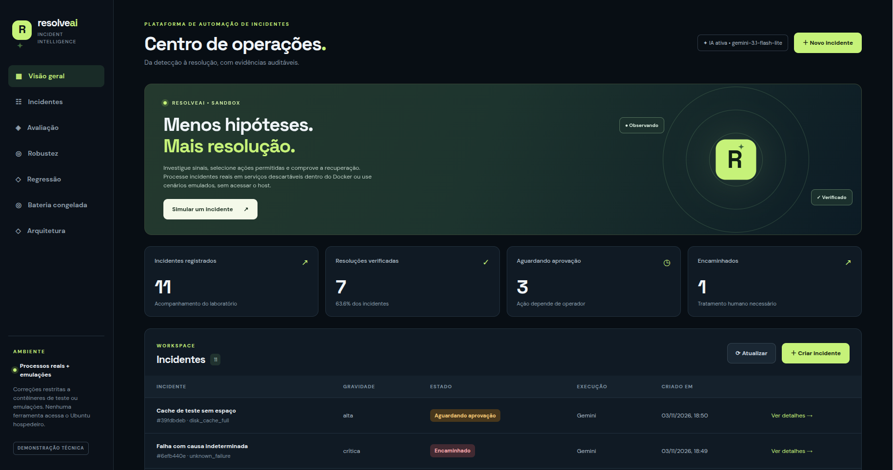
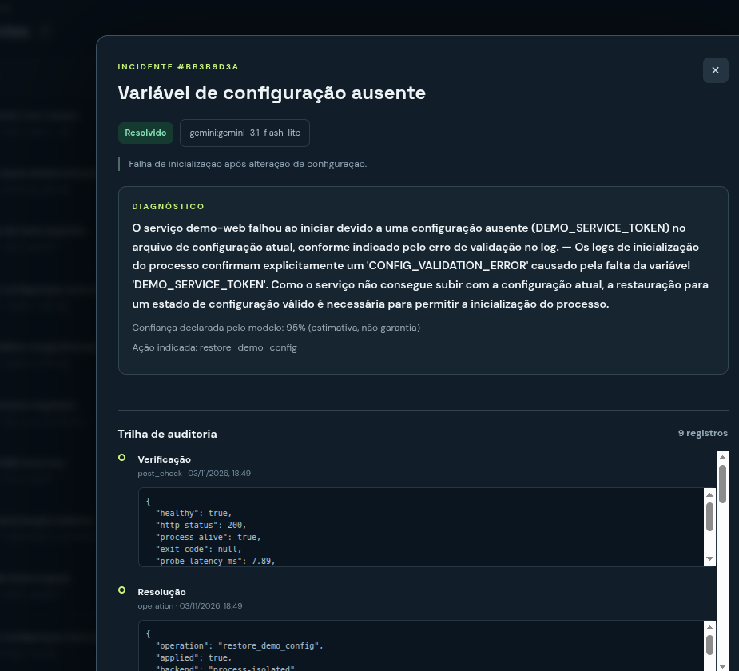
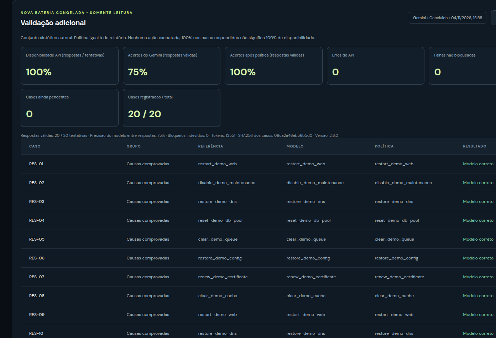
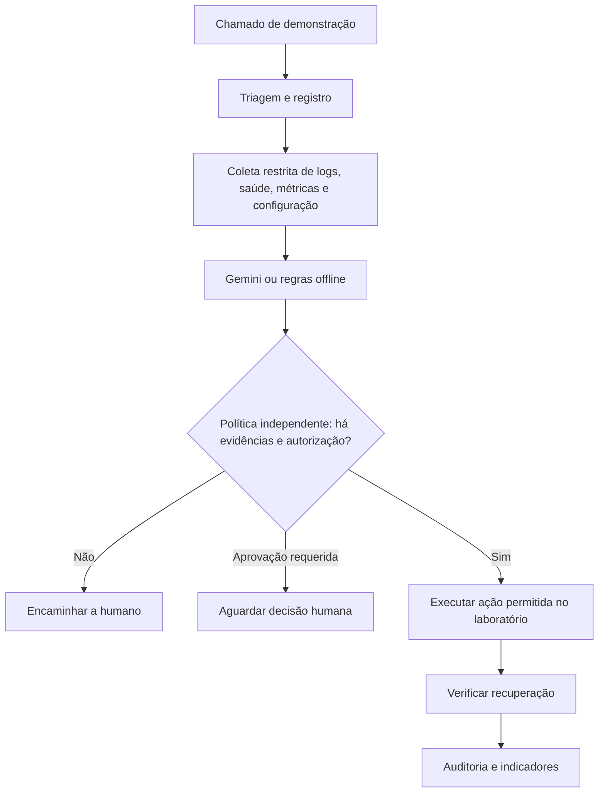

# ResolveAI — Diagnóstico e resolução assistida por IA

> **Versão técnica:** 2.8.0 · **Status:** protótipo de laboratório · **Idioma:** português

O **ResolveAI** é uma aplicação web que demonstra como inteligência artificial pode apoiar a investigação de incidentes de TI **sem conceder ao modelo acesso direto ao sistema operacional**. O projeto coleta evidências, solicita ao Gemini uma hipótese de causa e uma ação, valida a proposta por regras independentes, executa apenas ações autorizadas em um laboratório isolado e verifica o resultado.

O objetivo é demonstrar **automação responsável**, com decisões auditáveis, encaminhamento humano quando necessário e avaliação quantitativa. Não é um produto de operações em produção.

<!-- resolveai-screenshots:start -->
## Capturas da aplicação

As imagens abaixo mostram o ResolveAI 2.8 em funcionamento no laboratório de demonstração.

### Painel de operações



### Diagnóstico de incidente com Gemini



### Avaliação de 20 casos sintéticos



> **Interpretação:** estes resultados referem-se a **20 casos sintéticos de laboratório**. O resultado de 100% após a política não é uma garantia de segurança ou desempenho em produção, e a disponibilidade medida no relatório não representa disponibilidade contínua da API.
<!-- resolveai-screenshots:end -->

## O que a demonstração permite fazer

- Criar incidentes sintéticos de infraestrutura e aplicações, acompanhar a investigação e conferir os eventos de auditoria.
- Executar reparos permitidos em **serviços do laboratório**; três cenários usam processos HTTP reais dentro de um contêiner, e outros cenários são emulados.
- Comparar decisões da IA com uma política determinística e visualizar os resultados das avaliações.
- Testar a integração com **Gemini API** ou executar um modo claramente identificado como **regras offline**.
- Reproduzir falhas e indisponibilidade da API nos testes automatizados sem consumir cota do Gemini.
- Retomar uma bateria interrompida: resultados válidos compatíveis são reaproveitados e casos pendentes podem ser reavaliados.

**Não inclui:** RAG, memória documental, quatro agentes LLM independentes, monitoramento de servidores reais, SSH ou comandos arbitrários no Ubuntu. As classes de triagem, investigação e resolução são estágios programados; o Gemini é usado na etapa de diagnóstico.

## Arquitetura



- **Interface e API:** FastAPI, HTML/CSS/JavaScript.
- **Persistência:** SQLite, nos volumes locais do Docker.
- **Modelo de linguagem:** Gemini, por API; chave opcional para modo offline.
- **Ambiente isolado:** Docker Compose com aplicativo, controlador de laboratório e serviços HTTP de teste.
- **Controle de ações:** lista de ferramentas e operações permitidas, verificação de evidências e aprovação humana para ações sensíveis.

Veja [ARQUITETURA.md](ARQUITETURA.md) e [SEGURANCA_E_LIMITACOES.md](SEGURANCA_E_LIMITACOES.md).

## Executar no Ubuntu

**Pré-requisitos:** Docker Engine e Docker Compose, internet para usar Gemini e uma chave válida da API se desejar diagnóstico por IA. Não é necessária GPU: as chamadas de IA acontecem na nuvem. Com 8 GB de RAM é recomendável manter apenas os serviços necessários abertos.

```bash
# Dentro da pasta resolveai
cp .env.example .env
nano .env  # inserir sua chave em GEMINI_API_KEY, se for usar IA
./scripts/start_docker.sh
```

Se você já possui um arquivo `.env` funcional de uma instalação anterior, **preserve-o** em vez de sobrescrevê-lo. Não inclua sua chave em arquivos públicos.

Acesse **http://127.0.0.1:8501**. O indicador de configuração da IA não é, por si só, prova de uma chamada bem-sucedida: confira o campo *modelo* e a trilha de diagnóstico após investigar um novo incidente.

Verificar/encerrar:

```bash
docker compose ps
docker compose logs --tail=100 app
docker compose down       # mantém os volumes; não use -v se quiser preservar dados
```

Se reiniciar o computador e a página não abrir, volte à pasta `resolveai` e execute `./scripts/start_docker.sh` novamente.

## Demonstração sugerida

1. Abrir um incidente de **serviço web interrompido** e acompanhar diagnóstico, ação e verificação HTTP 200 no laboratório.
2. Abrir um caso de **causa indeterminada** para mostrar que o sistema encaminha em vez de inventar uma correção.
3. Mostrar a trilha de auditoria, a aprovação humana e o relatório de avaliação, distinguindo *acerto de decisão* de *recuperação real*.

O vídeo pode ser gravado com resultados já obtidos e descritos corretamente; não é necessário provocar novas chamadas durante a gravação. Veja [ROTEIRO_DEMO_3_MIN.md](ROTEIRO_DEMO_3_MIN.md).

## Avaliação — como interpretar

Na avaliação de **20 casos sintéticos**, executada no Ubuntu pelo operador em 04/11/2026, o resumo registrado indicou:

| Indicador | Resultado reportado |
|---|---:|
| Respostas válidas após retomada | 20/20 |
| Acertos de decisão do Gemini | 15/20 (75%) |
| Acertos após política de segurança | 20/20 (100%) |
| Falhas não recuperadas no relatório final | 0 |

Houve falhas HTTP 503 em execuções anteriores e uma recuperação por nova tentativa na execução concluída. Portanto, **20/20 respostas finais não significa disponibilidade contínua de 100%**. A política acertou o gabarito desta bateria, mas encaminhar um caso corretamente **não equivale a resolver automaticamente o incidente**.

Os casos são **sintéticos, preparados no projeto e conhecidos por sua autoria**. O resultado não demonstra generalização estatística nem segurança em produção. O JSON bruto dessa execução não acompanha este repositório: os números foram transcritos do terminal e das capturas exibidas pelo operador. Veja [RESULTADOS_E_METODOLOGIA.md](RESULTADOS_E_METODOLOGIA.md).

### Avaliação reproduzível

Somente regras, **sem chamadas Gemini**:

```bash
docker compose exec -T app python -m scripts.reserved --mode offline --limit 20
```

Com Gemini, **opcional e com consumo de cota de API**:

```bash
docker compose exec -T app python -m scripts.reserved --mode ai --confirm-api-usage --limit 20
```

Para continuar uma **avaliação compatível e parcialmente concluída**:

```bash
docker compose exec -T app python -m scripts.reserved --mode ai --confirm-api-usage --limit 20 --resume
```

A retomada exige que o relatório tenha o mesmo modelo, política, conjunto e limite dos casos. Um relatório incompatível é recusado para evitar mistura de resultados. Não execute a avaliação offline se quiser manter o último relatório de Gemini exibido no painel.

## Testes automatizados

```bash
python3 -m venv .venv
source .venv/bin/activate
python -m pip install -r requirements-dev.txt
python -m pytest -q
```

**120 testes aprovados** em ambiente Python local nesta preparação de portfólio. Este resultado não substitui os testes de execução dos contêineres e da API real no Ubuntu.

## Estrutura do projeto

```text
resolveai/
├── app/                 # API, lógica de diagnóstico, política e interface
├── lab/                 # controlador de laboratório
├── real_lab/            # serviços HTTP reais de teste
├── scripts/             # inicialização e avaliações
├── tests/               # testes automatizados
├── compose.yaml         # serviços Docker
├── VERSION              # versão do aplicativo
├── ARQUITETURA.md       # decisões técnicas
├── RESULTADOS_E_METODOLOGIA.md
├── SEGURANCA_E_LIMITACOES.md
├── ROTEIRO_DEMO_3_MIN.md
└── CHECKLIST_PUBLICACAO.md
```

## Transparência e responsabilidade

O projeto foi desenvolvido com assistência de ferramentas de IA. A documentação e os testes devem ser revisados e compreendidos por quem o apresenta; não atribua a si experimentos ou trabalho manual que não realizou. Para uso real, seriam necessários testes externos, controle de identidade, gestão de segredos, controle de acesso, observabilidade e avaliação de riscos em produção.

**Licença:** MIT (veja [LICENSE](LICENSE)). **Publicação:** somente após revisão de segredos e dados; não publique o `.env` nem resultados internos por engano.
